<p align="center">
  
</p>

<p align="center">
  <a href="https://www.linkedin.com/in/houssem-eddine-benazzi-586b5635a/">
    
  </a>
  <a href="https://ctftime.org/team/419024/">
    
  </a>
  <a href="mailto:h.benazzi@protonmail.com">
    
  </a>
</p>

<p align="center">
  
</p>

### `whoami.rs`

```rust
pub struct Operator<'a> {
    pub name: &'a str,
    pub role: &'a str,
    pub location: &'a str,
    pub specialties: &'a [&'a str],
    pub commercial_impact: &'a [&'a str],
    pub ctf_leadership: &'a [&'a str],
    pub education: &'a str,
    pub certifications: &'a [&'a str],
}

pub const HUSMUS9999: Operator<'static> = Operator {
    name: "Houssem Eddine Benazzi",
    role: "Cybersecurity Engineer @ AIUNIVERS (2+ YOE, Full-Time)",
    location: "Algiers, Algeria",
    specialties: &[
        "Application Security & Pentesting (Web, API, Android, AI/LLM)",
        "Mobile & Binary Analysis (Android APK/JNI, Linux ELF64, Frida)",
        "Systems Security Engineering (Zero-Dep Rust/C99, Anti-Stealth)",
        "MCP-Assisted Offensive, RE & SAST Security Automation",
    ],
    commercial_impact: &[
        "200+ manually validated vulnerabilities across web, API, mobile & AI",
        "Android POS hardening & external third-party pentest remediation",
    ],
    ctf_leadership: &[
        "Temperature0 Lead (#1 Algeria / #14 Global CTFtime peak, Mar 2026)",
        "Midnight Flag CTF 2026 International Finalist (France)",
    ],
    education: "B.Sc. CS — Network Infrastructure & Cybersecurity (1st/10, NIT)",
    certifications: &[
        "CLLMSE (LLM Security Expert)",
        "CCPP (C++ Practitioner)",
        "CCNAv7 (Intro to Networks)",
    ],
};
```

<p align="center">
  
</p>

### Technical Skills & Security Arsenal

<p align="center">
  
  <br />
  
</p>

<br />

| Domain | Core Capabilities & Tooling |
|---|---|
| **Offensive & AppSec** | Web, API & Android penetration testing (`Burp Suite`, `Caido`) · `OWASP Top 10` & `MASVS` · SAST & secure code review · threat modeling · `CWE`/`CVSS` reporting & remediation validation |
| **Mobile & Binary RE** | Android `APK`/`JNI` & Linux `ELF64` static/dynamic analysis · `Frida` instrumentation & SSL-pinning bypass · deobfuscation · `Ghidra`, `IDA Pro`, `Binary Ninja`, `jadx`, `apktool`, `GDB`, `Detect It Easy` · CTF tooling (`pwntools`, `angr`, `AFL++`, `Z3`) |
| **Security Engineering** | Zero-dependency `Rust` & `C99` asset/binary sealing (`AES-256-GCM`, `ECDH P-256`, `ChaCha20-Poly1305`, `memfd_create`/`memfd_secret`) · anti-repeater & anti-stealth browser defenses |
| **AI / LLM Security** | `OWASP Top 10 for LLM Applications` · AI & `MCP` red teaming · prompt injection, jailbreak & RAG security · deterministic guardrails · multi-agent security automation (`Caido MCP`, `IDA`/`Binja MCP`, `CVE`/`NVD` retrieval, `LangChain`) |
| **Systems & DevSecOps** | `Python`, `C`, `C++`, `Go`, `Rust`, `JavaScript`, `SQL` · Linux hardening (`Debian`, `Ubuntu`, `Kali`, `Parrot OS`) · `PostgreSQL`/`pgvector`, `PostGIS`, `Redis` · `AWS`, `Docker`, rootless `Podman`, CI/CD (`GitHub Actions`, `CircleCI`, `Jenkins`), `Grafana`, `Prometheus` |

<p align="center">
  
</p>

### Featured Original Projects

| Project | Domain | Stack | Highlights | Build / Metric |
|---|---|---|---|---|
| [**vibe-slayer**](https://github.com/HUSMUS9999/vibe-slayer) | Asset & Binary Sealing | `Rust` · `C99` | Zero-crate `AES-256-GCM`/`ECDH P-256` leases, static-PIE Intel CET `ELF64` wrapping (`memfd_create`/`memfd_secret`), and `ChaCha20-Poly1305` vaults. |  |
| [**proxysnare**](https://github.com/HUSMUS9999/proxysnare) | Anti-Repeater Defense | `JS` · `Python` | Zero-dependency HTTP Repeater & proxy shield with non-extractable WebCrypto keys, `HMAC-SHA256` Proof-of-Freshness, and rotating honey-canaries. |  |
| [**veilbreak**](https://github.com/HUSMUS9999/veilbreak) | Browser Integrity Gate | `JS` · `Python` | Zero-dependency Chromium/Gecko anti-stealth gate: 14 invariants, `iframe`/`Web Worker` coherence, pointer kinematics, and single-use tickets. |  |
| [**crushgrid**](https://github.com/HUSMUS9999/crushgrid) | Distributed Archival | `Rust` | Single-binary multi-node cluster with `BLAKE3` dedup, `AES-256-GCM` transport, and per-slab routing (`Zstd`, `Bzip3`, `LZMA2`, `LZMA2+BCJ`, `PPMd7`, `LZ4`). |  |

#### Active Private R&D & Competitive Security
- **Multi-Agent RE, Pwn & AppSec Workbench** — Specialized agents wired via MCP to IDA Pro, Binary Ninja, Detect It Easy, Caido, CVE/NVD retrieval, and fuzzing/symbolic engines (`AFL++`, `angr`) with verified-fact grounding and human review.
- **RiskIntel** — Geospatial threat-event aggregation platform in `Go`, `Python`, `PostgreSQL`/`pgvector`, `PostGIS`, and `Redis` with semantic deduplication and guardrailed assistants.
- **Temperature0 CTF** — Lead a 4-member team focusing on RE, binary exploitation, and web security; peak **#1 Algeria / #14 Global** (March 2026), **Midnight Flag CTF 2026 International Finalist** (France), `#6` UNbreakable International 2026, `#13` ApoorvCTF, `#19` UTCTF.
