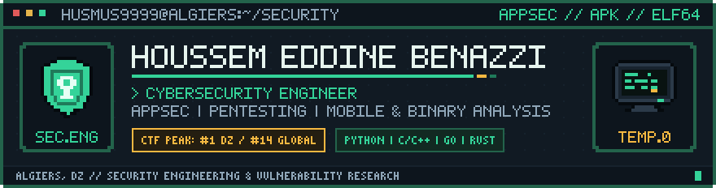
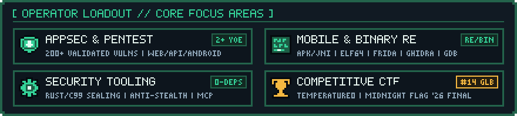

  <picture>
    <source media="(prefers-color-scheme: dark)" srcset="assets/pixel-banner-dark.svg" />
    <source media="(prefers-color-scheme: light)" srcset="assets/pixel-banner-light.svg" />
    
  </picture>

Cybersecurity Engineer focused on **application security, penetration testing, Android/ELF binary analysis, and defensive systems engineering**. I build zero-dependency security tools in **Rust, C/C++, Go, Python, and JavaScript**, lead the competitive CTF team [**Temperature0**](https://ctftime.org/team/419024/) (`#1 Algeria` / `#14 Global` CTFtime peak, Midnight Flag CTF 2026 Finalist), and develop MCP-assisted offensive/defensive security workflows.

  <picture>
    <source media="(prefers-color-scheme: dark)" srcset="assets/pixel-loadout-dark.svg" />
    <source media="(prefers-color-scheme: light)" srcset="assets/pixel-loadout-light.svg" />
    
  </picture>

### Selected Original Projects

| Project | Focus | Stack | Summary |
|---|---|---|---|
| [**vibe-slayer**](https://github.com/HUSMUS9999/vibe-slayer) | Asset & Binary Sealing | `Rust` · `C99` (`0` crates) | Standalone cryptographic delivery and Linux `ELF64` static-PIE Intel CET wrapping (`memfd_create`/`memfd_secret`) with `AES-256-GCM`/`ECDH P-256` leases and `ChaCha20-Poly1305` vaults. |
| [**proxysnare**](https://github.com/HUSMUS9999/proxysnare) | Anti-Repeater Defense | `JavaScript` · `Python` (`0` deps) | Defends browser-driven web APIs against HTTP repeaters and intercepting proxies using non-extractable WebCrypto keys, `HMAC-SHA256` Proof-of-Freshness, and rotating honey-canaries. |
| [**veilbreak**](https://github.com/HUSMUS9999/veilbreak) | Browser Integrity Gate | `JavaScript` · `Python` (`0` deps) | Cross-engine Chromium/Gecko anti-stealth detection combining 14 browser invariants with pointer/click kinematics and server-side attestation. |
| [**crushgrid**](https://github.com/HUSMUS9999/crushgrid) | Distributed Encrypted Archival | `Rust` (single static binary) | Multi-node work-stealing compression CLI with `BLAKE3` deduplication, `AES-256-GCM` authenticated transport, and automatic per-slab routing across 6 codecs (`Zstd`, `Bzip3`, `LZMA2`, `LZMA2+BCJ`, `PPMd7`, `LZ4`). |

---

### Links

- **LinkedIn:** [linkedin.com/in/houssem-eddine-benazzi-586b5635a](https://www.linkedin.com/in/houssem-eddine-benazzi-586b5635a/)
- **CTFtime:** [Temperature0 (`ctftime.org/team/419024`)](https://ctftime.org/team/419024/)
- **Email:** `h.benazzi@protonmail.com`
