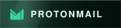
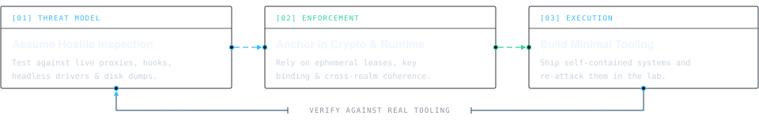
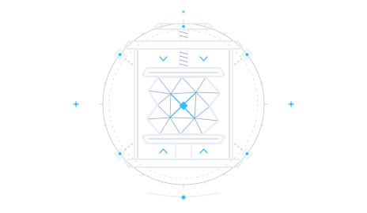
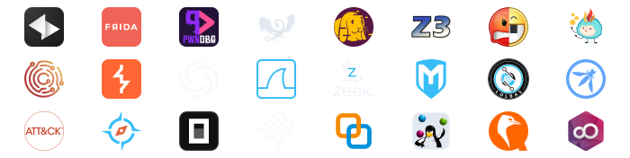

  <picture>
    <source media="(prefers-color-scheme: dark)" srcset="assets/hero-dark.svg" />
    <source media="(prefers-color-scheme: light)" srcset="assets/hero-light.svg" />
    
  </picture>

### Contact

  <a href="https://www.linkedin.com/in/houssem-eddine-benazzi-586b5635a/" title="LinkedIn"><picture><source media="(prefers-color-scheme: dark)" srcset="assets/badges/badge-linkedin-dark.svg" /><source media="(prefers-color-scheme: light)" srcset="assets/badges/badge-linkedin-light.svg" /></picture></a>&nbsp;&nbsp;&nbsp;<a href="https://ctftime.org/team/419024/" title="CTFtime — Temp0"><picture><source media="(prefers-color-scheme: dark)" srcset="assets/badges/badge-ctftime-dark.svg" /><source media="(prefers-color-scheme: light)" srcset="assets/badges/badge-ctftime-light.svg" /></picture></a>&nbsp;&nbsp;&nbsp;<a href="mailto:h.benazzi@protonmail.com" title="ProtonMail — h.benazzi@protonmail.com"><picture><source media="(prefers-color-scheme: dark)" srcset="assets/badges/badge-mail-dark.svg" /><source media="(prefers-color-scheme: light)" srcset="assets/badges/badge-mail-light.svg" /></picture></a>&nbsp;&nbsp;&nbsp;<a href="https://discord.com/users/_husmus" title="Discord: _husmus"><picture><source media="(prefers-color-scheme: dark)" srcset="assets/badges/badge-discord-dark.svg" /><source media="(prefers-color-scheme: light)" srcset="assets/badges/badge-discord-light.svg" /></picture></a>

  <picture>
    <source media="(prefers-color-scheme: dark)" srcset="assets/divider-dark.svg" />
    <source media="(prefers-color-scheme: light)" srcset="assets/divider-light.svg" />
    
  </picture>

### Approach

Most messy systems are simple machines buried under too many layers. I start with **Occam's razor**: pare a problem down until the real mechanics sit in plain sight, because extra indirection is where bugs hide.

**Critical thinking** means refusing to take defaults, specs, or boundaries at face value. Asking what breaks when an assumed invariant slips gets further than running another checklist.

Everyone has the same tools and frameworks. **Creativity** is the edge you cannot install: spotting the sideways angle nobody modeled, and combining ordinary pieces into a cleaner design.

  <picture>
    <source media="(prefers-color-scheme: dark)" srcset="assets/methodology-dark.svg" />
    <source media="(prefers-color-scheme: light)" srcset="assets/methodology-light.svg" />
    
  </picture>

  <picture>
    <source media="(prefers-color-scheme: dark)" srcset="assets/divider-dark.svg" />
    <source media="(prefers-color-scheme: light)" srcset="assets/divider-light.svg" />
    
  </picture>

### Open-Source Work

<table>
  <tr>
    <td width="50%" valign="top">
      

        <a href="https://github.com/HusX99/vibe-slayer"><picture><source media="(prefers-color-scheme: dark)" srcset="assets/emblems/vibeslayer-dark.svg" /><source media="(prefers-color-scheme: light)" srcset="assets/emblems/vibeslayer-light.svg" /></picture></a>
      

      

        <a href="https://github.com/HusX99/vibe-slayer"><strong>vibe-slayer</strong></a> <samp>Rust / C99</samp>
      

      
Seals and delivers Linux <code>ELF64</code> binaries and static assets so payloads stay encrypted on disk. Pairs static-PIE Intel CET binaries with ephemeral AES-256-GCM / ECDH P-256 leases and headerless ChaCha20-Poly1305 vaults.

    </td>
    <td width="50%" valign="top">
      

        <a href="https://github.com/HusX99/proxysnare"><picture><source media="(prefers-color-scheme: dark)" srcset="assets/emblems/proxysnare-dark.svg" /><source media="(prefers-color-scheme: light)" srcset="assets/emblems/proxysnare-light.svg" /></picture></a>
      

      

        <a href="https://github.com/HusX99/proxysnare"><strong>proxysnare</strong></a> <samp>JS / Python</samp>
      

      
Breaks out-of-band Burp and Caido Repeater tampering and naive MitM replay without shipping static client secrets. Requests bind to non-extractable WebCrypto keys, single-use HMAC-SHA256 freshness proofs, and rotating decoy canaries.

    </td>
  </tr>
  <tr>
    <td width="50%" valign="top">
      

        <a href="https://github.com/HusX99/veilbreak"><picture><source media="(prefers-color-scheme: dark)" srcset="assets/emblems/veilbreak-dark.svg" /><source media="(prefers-color-scheme: light)" srcset="assets/emblems/veilbreak-light.svg" /></picture></a>
      

      

        <a href="https://github.com/HusX99/veilbreak"><strong>veilbreak</strong></a> <samp>JS / Python</samp>
      

      
Detects headless and stealth-patched browsers where spoofing leaks across execution boundaries. Verifies 14 Chromium/Gecko runtime checks, <code>iframe</code> and Web Worker coherence, input timing, and single-use server tickets.

    </td>
    <td width="50%" valign="top">
      

        <a href="https://github.com/HusX99/crushgrid"><picture><source media="(prefers-color-scheme: dark)" srcset="assets/emblems/crushgrid-dark.svg" /><source media="(prefers-color-scheme: light)" srcset="assets/emblems/crushgrid-light.svg" /></picture></a>
      

      

        <a href="https://github.com/HusX99/crushgrid"><strong>crushgrid</strong></a> <samp>Rust</samp>
      

      
Archives mixed binary and text corpora where any single compressor leaves ratio on the table. Routes slabs across Zstd, Bzip3, LZMA2 (+BCJ), PPMd7, and LZ4 with BLAKE3 deduplication and AES-256-GCM cluster framing.

    </td>
  </tr>
</table>

  <picture>
    <source media="(prefers-color-scheme: dark)" srcset="assets/divider-dark.svg" />
    <source media="(prefers-color-scheme: light)" srcset="assets/divider-light.svg" />
    
  </picture>

### Workbench

  <picture>
    <source media="(prefers-color-scheme: dark)" srcset="assets/tooling-grid-dark.svg" />
    <source media="(prefers-color-scheme: light)" srcset="assets/tooling-grid-light.svg" />
    
  </picture>

