<p align="center">
  
</p>

<p align="center">
  
</p>

<p align="center">
  <a href="https://www.linkedin.com/in/houssem-eddine-benazzi-586b5635a/">
    
  </a>
  <a href="https://ctftime.org/team/419024/">
    
  </a>
  <a href="mailto:h.benazzi@protonmail.com">
    
  </a>
</p>

<p align="center">
  
</p>

### `whoami.rs`

```rust
pub struct Operator<'a> {
    pub name: &'a str,
    pub role: &'a str,
    pub location: &'a str,
    pub specialties: &'a [&'a str],
    pub commercial_impact: &'a str,
    pub ctf_leadership: &'a str,
    pub education: &'a str,
    pub certifications: &'a [&'a str],
}

pub const HUSMUS9999: Operator = Operator {
    name: "Houssem Eddine Benazzi",
    role: "Cybersecurity Engineer @ AIUNIVERS (2+ YOE, Full-Time)",
    location: "Algiers, Algeria",
    specialties: &[
        "Application Security & Penetration Testing (Web, API, Android, AI/LLM)",
        "Mobile & Binary Analysis (Android APK/JNI, Linux ELF64, Frida)",
        "Systems Security Engineering (Zero-Dep Rust/C99, Anti-Stealth, Anti-Replay)",
        "MCP-Assisted Offensive, RE & SAST Security Automation",
    ],
    commercial_impact: "200+ manually validated vulnerabilities | Android POS hardening & external third-party pentest remediation",
    ctf_leadership: "Temperature0 Lead (#1 Algeria / #14 Global CTFtime peak) | Midnight Flag CTF 2026 Finalist (France)",
    education: "B.Sc. Computer Science — Network Infrastructure & Cybersecurity (1st of 10, NIT)",
    certifications: &["CLLMSE (LLM Security Expert)", "CCPP (C++ Practitioner)", "CCNAv7"],
};
```

<p align="center">
  
</p>

### Technical Skills & Security Arsenal

#### Languages, Systems & DevSecOps

<p align="center">
  
  <br />
  
</p>

#### Offensive Security & Application Security
<p>
  
  
  
  
  
  
  
</p>

#### Reverse Engineering & Binary Analysis
<p>
  
  
  
  
  
  
  
  
</p>

#### AI / LLM Security & Security Automation
<p>
  
  
  
  
  
  
</p>

<p align="center">
  
</p>

### Featured Original Projects

| Project | Domain | Stack | What It Does | Status |
|---|---|---|---|---|
| [**vibe-slayer**](https://github.com/HUSMUS9999/vibe-slayer) | Asset & Binary Sealing | `Rust` · `C99` | Zero-crate cryptographic delivery (`AES-256-GCM` / `ECDH P-256` leases), static-PIE Intel CET Linux `ELF64` wrapping (`memfd_create`/`memfd_secret`), and headerless `ChaCha20-Poly1305` vaults. |  |
| [**proxysnare**](https://github.com/HUSMUS9999/proxysnare) | Anti-Repeater Defense | `JS` · `Python` | Zero-dependency HTTP Repeater & intercepting-proxy defense with non-extractable WebCrypto keys, single-use `HMAC-SHA256` Proof-of-Freshness, and rotating honey-canaries. |  |
| [**veilbreak**](https://github.com/HUSMUS9999/veilbreak) | Browser Integrity Gate | `JS` · `Python` | Zero-dependency Chromium/Gecko anti-stealth gate combining 14 cross-engine invariants, `iframe`/`Web Worker` checks, pointer/click kinematics, and single-use server tickets. |  |
| [**crushgrid**](https://github.com/HUSMUS9999/crushgrid) | Distributed Archival | `Rust` | Single-binary multi-node compression cluster with `BLAKE3` dedup, `AES-256-GCM` transport, and per-slab routing across 6 codecs (`Zstd`, `Bzip3`, `LZMA2`, `LZMA2+BCJ`, `PPMd7`, `LZ4`). |  |

#### Active Private R&D & Competitive Security
- **Multi-Agent RE, Pwn & AppSec Workbench** — Specialized agents wired via MCP to IDA Pro, Binary Ninja, Detect It Easy, Caido, CVE/NVD retrieval, and fuzzing/symbolic engines (`AFL++`, `angr`) with verified-fact grounding and human review.
- **RiskIntel** — Geospatial threat-event aggregation platform in `Go`, `Python`, `PostgreSQL`/`pgvector`, `PostGIS`, and `Redis` with semantic deduplication and guardrailed assistants.
- **Temperature0 CTF** — Lead a 4-member team focusing on RE, binary exploitation, and web security; archived peak **#1 Algeria / #14 Global** (March 2026), **Midnight Flag CTF 2026 International Finalist** (France), `#6` UNbreakable International 2026, `#13` ApoorvCTF, `#19` UTCTF.

<p align="center">
  
</p>

### Live GitHub Activity

<p align="center">
  
  
</p>

<p align="center">
  
</p>
