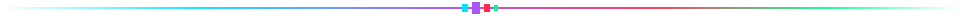
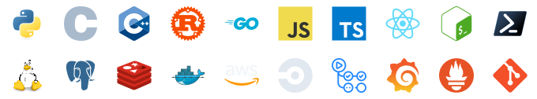

<p align="center">
  
</p>

<p align="center">
  <a href="https://www.linkedin.com/in/houssem-eddine-benazzi-586b5635a/"></a>
  <a href="https://ctftime.org/team/419024/"></a>
  <a href="mailto:h.benazzi@protonmail.com"></a>
</p>

<p align="center">
  
</p>

### `whoami.rs`

```rust
pub struct Profile<'a> {
    pub handle: &'a str,
    pub focus: &'a [&'a str],
    pub ctf_team: &'a str,
    pub languages: &'a [&'a str],
    pub open_source: &'a [&'a str],
}

pub const HUSMUS9999: Profile<'static> = Profile {
    handle: "Houssem Eddine Benazzi",
    focus: &[
        "Application Security & Penetration Testing",
        "Reverse Engineering & Binary Analysis",
        "Defensive Systems Engineering & Anti-Abuse Tooling",
        "AI / LLM Security & Security Automation",
    ],
    ctf_team: "Temperature0 — #14 Global CTFtime Peak",
    languages: &[
        "Python", "C", "C++", "Go", "Rust",
        "JavaScript", "TypeScript", "SQL", "Bash", "PowerShell",
    ],
    open_source: &["vibe-slayer", "proxysnare", "veilbreak", "crushgrid"],
};
```

<p align="center">
  
</p>

### Skills & Focus Areas

<p align="center">
  <picture>
    <source media="(prefers-color-scheme: dark)" srcset="assets/skills-grid-dark.svg" />
    <source media="(prefers-color-scheme: light)" srcset="assets/skills-grid-light.svg" />
    
  </picture>
</p>

<br />

| Domain | Focus |
|---|---|
| **Application Security** | Web, API, and mobile security assessments · secure code review · threat modeling · vulnerability validation & remediation |
| **Reverse Engineering** | Static & dynamic binary analysis · runtime instrumentation · deobfuscation · native & mobile hardening |
| **Security Engineering** | Cryptographic asset & binary sealing · anti-replay & anti-stealth browser defenses · distributed systems |
| **AI & Automation** | LLM & agentic security · adversarial testing · guardrails · automated security research workflows |
| **Systems & DevSecOps** | Linux & Windows scripting · containerization · CI/CD security pipelines · high-performance backend & telemetry systems |

<p align="center">
  
</p>

### Open-Source Projects

<table>
  <tr>
    <td width="50%" valign="top">
      <p align="center">
        <a href="https://github.com/HUSMUS9999/vibe-slayer">
          <picture>
            <source media="(prefers-color-scheme: dark)" srcset="https://raw.githubusercontent.com/HUSMUS9999/vibe-slayer/main/assets/vibeslayer-hero-dark.svg" />
            <source media="(prefers-color-scheme: light)" srcset="https://raw.githubusercontent.com/HUSMUS9999/vibe-slayer/main/assets/vibeslayer-hero-light.svg" />
            
          </picture>
        </a>
      </p>
      <p align="center">
        <a href="https://github.com/HUSMUS9999/vibe-slayer"><strong>vibe-slayer</strong></a> &nbsp;·&nbsp; <code>Rust</code> · <code>C99</code>
        <br />
        
      </p>
      <p>Cryptographic delivery (<code>AES-256-GCM</code> / <code>ECDH P-256</code> leases), static-PIE Intel CET Linux <code>ELF64</code> sealing, and headerless <code>ChaCha20-Poly1305</code> vaults.</p>
    </td>
    <td width="50%" valign="top">
      <p align="center">
        <a href="https://github.com/HUSMUS9999/proxysnare">
          <picture>
            <source media="(prefers-color-scheme: dark)" srcset="https://raw.githubusercontent.com/HUSMUS9999/proxysnare/main/assets/proxysnare-hero-dark.svg" />
            <source media="(prefers-color-scheme: light)" srcset="https://raw.githubusercontent.com/HUSMUS9999/proxysnare/main/assets/proxysnare-hero-light.svg" />
            
          </picture>
        </a>
      </p>
      <p align="center">
        <a href="https://github.com/HUSMUS9999/proxysnare"><strong>proxysnare</strong></a> &nbsp;·&nbsp; <code>JS</code> · <code>Python</code>
        <br />
        
      </p>
      <p>HTTP Repeater &amp; intercepting-proxy defense using non-extractable WebCrypto keys, single-use Proof-of-Freshness signatures, and rotating honey-canaries.</p>
    </td>
  </tr>
  <tr>
    <td width="50%" valign="top">
      <p align="center">
        <a href="https://github.com/HUSMUS9999/veilbreak">
          <picture>
            <source media="(prefers-color-scheme: dark)" srcset="https://raw.githubusercontent.com/HUSMUS9999/veilbreak/main/assets/veilbreak-hero-dark.svg" />
            <source media="(prefers-color-scheme: light)" srcset="https://raw.githubusercontent.com/HUSMUS9999/veilbreak/main/assets/veilbreak-hero-light.svg" />
            
          </picture>
        </a>
      </p>
      <p align="center">
        <a href="https://github.com/HUSMUS9999/veilbreak"><strong>veilbreak</strong></a> &nbsp;·&nbsp; <code>JS</code> · <code>Python</code>
        <br />
        
      </p>
      <p>Chromium/Gecko browser integrity gate combining 14 cross-engine invariants, <code>iframe</code>/<code>Web Worker</code> coherence checks, pointer kinematics, and single-use server tickets.</p>
    </td>
    <td width="50%" valign="top">
      <p align="center">
        <a href="https://github.com/HUSMUS9999/crushgrid">
          <picture>
            <source media="(prefers-color-scheme: dark)" srcset="https://raw.githubusercontent.com/HUSMUS9999/crushgrid/main/assets/crushgrid-emblem-dark.svg" />
            <source media="(prefers-color-scheme: light)" srcset="https://raw.githubusercontent.com/HUSMUS9999/crushgrid/main/assets/crushgrid-emblem-light.svg" />
            
          </picture>
        </a>
      </p>
      <p align="center">
        <a href="https://github.com/HUSMUS9999/crushgrid"><strong>crushgrid</strong></a> &nbsp;·&nbsp; <code>Rust</code>
        <br />
        
        
      </p>
      <p>Distributed multi-node compression CLI with <code>BLAKE3</code> deduplication, <code>AES-256-GCM</code> cluster framing, and per-slab routing across <code>Zstd</code>, <code>Bzip3</code>, <code>LZMA2</code>, <code>LZMA2+BCJ</code>, <code>PPMd7</code>, and <code>LZ4</code>.</p>
    </td>
  </tr>
</table>
